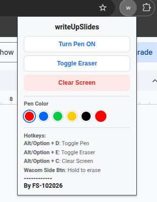

# writeUpSlides

A Chrome extension for drawing by hand on top of Google Slides: circle things, underline them, or sketch a diagram while you present or edit. It works with a mouse, a touchscreen, or a pen tablet such as a Wacom, including its side button.

Your ink sits on a transparent layer above the page. It never changes the presentation itself, and you can clear it at any time.

## Installation

The extension isn't on the Chrome Web Store, so you load it yourself in Chrome's developer mode. This takes about a minute and works in Chrome, Edge, Brave and other Chromium browsers.

1. **Get the files:**
   - **Packaged version:** download [`dist/writeUpSlides-v1.8.zip`](dist/writeUpSlides-v1.8.zip) and unzip it into a folder you'll keep, such as `Documents/writeUpSlides`. Chrome loads the extension from that folder every time it starts, so don't delete it.
   - **From source:** `git clone https://github.com/fsantibanezc/writeUpSlides.git`
2. Open `chrome://extensions` in the address bar.
3. Turn on **Developer mode** (the switch at the top right).
4. Click **Load unpacked** and choose the folder that contains `manifest.json`.
5. Optional: click the puzzle-piece icon in the toolbar and pin **writeUpSlides** so its button is always visible.
6. **Reload any Google Slides tabs that were already open.**

### Updating

Replace the folder's contents with the new version, click the reload icon on the extension's card in `chrome://extensions`, then reload your Slides tabs.

## Using it

Open a presentation at `docs.google.com/presentation/...`. You can be editing it or presenting it.

### The popup menu

Click the extension's button in the Chrome toolbar to open the menu. If you haven't pinned it, click the puzzle-piece icon first. Chrome shows it as a gray circle with a **w**.

  

From top to bottom:

1. **Turn Pen ON** (blue text) starts drawing on the presentation. The button turns solid blue and changes to **Turn Pen OFF**. While the pen is on, mouse and pen clicks draw instead of reaching the slide. Turn it off to click links, select objects or advance slides again. Shortcut: `Alt/Option + D`.
2. **Toggle Eraser** switches between the pen and the eraser. While erasing, the button turns solid blue and reads **Eraser Active**. The eraser is wider than the pen and removes only ink, never the slide's content. Picking a color switches back to the pen automatically. Shortcut: `Alt/Option + E`.
3. **Clear Screen** (red) erases all ink at once. The label briefly changes to **Cleared!** to confirm. There's no undo. Shortcut: `Alt/Option + C`.
4. **Pen Color** has six circles. Click one to draw in that color; the selected color has a blue ring.
   - The first five are presets: **red** (the default), **blue**, **green**, **yellow** and **black**.
   - The sixth circle is a **custom color picker**. Click it to choose any color from the system color chooser. It shows the last custom color you picked, which starts as red.
5. **Hotkeys** is a reminder of the keyboard shortcuts, not a set of buttons. See [Keyboard shortcuts](#keyboard-shortcuts) below. **Wacom Side Btn: Hold to erase** means that holding a tablet pen's side button turns that stroke into an eraser.
6. **By FS-102026** is the author credit.

The menu always shows the current state of the Slides tab, so if you turned the pen on with a hotkey, the menu shows **Turn Pen OFF** when you open it. If the tab isn't a Google Slides presentation, or the extension can't reach it, a yellow note at the top of the menu explains what to do (see [Troubleshooting](#troubleshooting)).

### Keyboard shortcuts

| Windows / Linux | Mac | Action |
|---|---|---|
| `Alt + D` | `Option + D` | Turn the pen on or off |
| `Alt + E` | `Option + E` | Turn the eraser on or off |
| `Alt + C` | `Option + C` | Clear all ink |

The shortcuts work while editing and while presenting. Click on the presentation first so the tab has keyboard focus.

### Pen tablets (Wacom and similar)

- Draw with the pen tip.
- Hold the **side (barrel) button** while drawing to erase, or flip the pen and use its **eraser end**, if it has one.
- Without a tablet, holding the right mouse button while dragging also erases.

### Typical presenting workflow

1. Start presenting (**Slideshow**).
2. Press `Alt + D` and draw.
3. Press `Alt + C` to clear, then `Alt + D` to turn the pen off.
4. Advance to the next slide with the keyboard or a click.

## Things to know

- **Ink belongs to the screen, not the slide.** It stays in place when you change slides, so clear it before moving on.
- **Ink is temporary.** It isn't saved with the presentation and disappears when you reload the tab.
- **Resizing the window or entering fullscreen keeps your ink,** but it stays at the same spot on the screen. If the slide moves or changes size, the ink won't line up with it anymore.
- There is no undo. Use the eraser or **Clear Screen**.

## Troubleshooting

| Problem | Fix |
|---|---|
| The popup says it *couldn't reach the page*. | Reload the Slides tab. This happens after the extension is installed, updated or reloaded. |
| The popup says *Open a Google Slides presentation*. | The extension only works on `docs.google.com/presentation/` pages. |
| Clicks don't reach the slide even with the pen off. | Reload the tab. If it keeps happening, check `chrome://extensions` for a second copy of writeUpSlides (or an older copy named "Slides Free Draw") and remove it. |
| The shortcuts do nothing. | Click on the presentation first so the page has keyboard focus. Check that no other extension uses the same keys. |
| A pen tablet scrolls or selects text instead of drawing. | Make sure the pen is turned on. In the tablet driver settings, turn off "Windows Ink" gestures or flicks if they're on. |

## Permissions

| Permission | Why it's needed |
|---|---|
| `activeTab` | Lets the popup talk to the Slides tab you're looking at. |
| `scripting` | Lets the popup add the drawing layer to a tab that was open before the extension was installed or updated. |

The extension only runs on `docs.google.com/presentation/*`. It collects no data and makes no network requests.

## For developers

| File | Role |
|---|---|
| `manifest.json` | Extension manifest (Manifest V3). |
| `content.js` | Drawing layer: canvas, strokes, eraser, shortcuts and fullscreen handling. |
| `popup.html`, `popup.js` | Toolbar popup. |
| `package.sh` | Builds `dist/writeUpSlides-v<version>.zip` from the files above. |

To make a release, bump `"version"` in `manifest.json`, run `./package.sh` and commit the new zip in `dist/`. The same zip can be uploaded to the Chrome Web Store.

## License

MIT. See [LICENSE](LICENSE).
